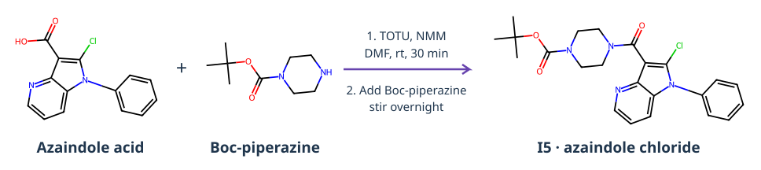

# US8580813B2 · RENIN

## Example 1, step 5 · I5 · azaindole chloride

| Lookup field | Extracted detail |
| --- | --- |
| SAR Brain molecule | `m_3ce6dce6f7fc` (viewer label I5) |
| Transformation | Amide coupling of the step 4 azaindole-3-carboxylic acid with N-Boc-piperazine. The product retains the C2 chloride. |
| Activation | Step 4 acid (460 mg, 1.69 mmol), DMF (24 mL), N-methylmorpholine (NMM, 478 µL, 4.35 mmol) and TOTU (627 mg, 1.91 mmol). Stir at room temperature for 30 min. |
| Coupling | Add N-Boc-piperazine (356 mg, 1.91 mmol) and stir overnight. |
| Isolation | Water quench and ethyl acetate extraction. Wash with saturated aqueous sodium bicarbonate, dry over sodium sulfate, filter and concentrate. Silica chromatography with 70–95% ethyl acetate in heptane gave 390 mg of product. |
| Source | [Patent procedure, Example 1, step 5](https://patents.google.com/patent/US8580813B2/en#:~:text=Step5%3A%204-(2-Chloro) |

**Replay use.** Making CPD 177 leaves I5 in the simulated inventory. CPD 121 then costs two additional operations, down from nine at the start of this replay. Those counts come from the RENIN route graph and inventory assumptions.
