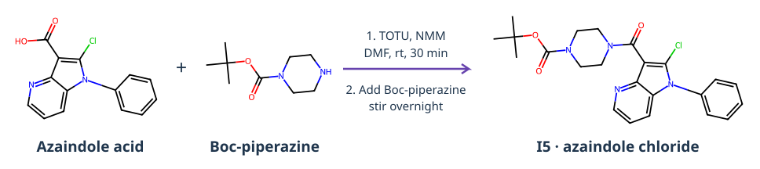

# The reinforcement learning environment of medicinal chemistry

*A patent-based framework for choosing what to predict, make and measure*

A chemist makes a compound that looks promising on the computer. The assay comes back six times weaker than predicted. Was it a poor choice? In a campaign against the enzyme renin, making that compound also produces an intermediate needed for a second candidate. That second experiment now costs two synthesis steps instead of nine. To judge the first decision, we need to know what the chemist learned **and what became possible next**.

We built SAR Brain to make that question experimentally accessible. We turn a completed campaign into a sequence of decisions that a person or an agent can play again. The player sees the candidate structures, their routes and a few opening measurements. The remaining activities are hidden. Every player can face the same starting position, choose a different first move and see its consequences all the way to the final assay. This gives us a way to formalize the choice at the heart of an automated medicinal chemistry campaign. Given everything learned and prepared so far, which experiment should come next?

## What the patent gives us

A medicinal chemistry patent can describe how a family of molecules was made. One example might give a full preparation. Another might refer back to that procedure and change the last reagent. We follow those references and connect each identifiable starting material, intermediate and product through the reported operations. When two preparations pass through the same identifiable intermediate, their routes meet. We match the resulting product structures to activity measurements for the target under study. The playable set consists of compounds for which we can connect an assay result to a priced route. Compounds a team considered but never tested have no experimental answer for this replay.

RENIN illustrates the distinction between a patent and a campaign record. The patent documents preparation of an azaindole chloride. The public RetroDMTA dataset supplies renin activities and recorded experimental dates. The demonstration starts with 15 measured references and offers 26 further compounds from the selected branch. This is a slice of the historical program. The same environment also runs ABL1 and S1P1 campaigns, with 79 and 74 compounds respectively. [Renin patent](https://patents.google.com/patent/US8580813B2/en) · [RetroDMTA dataset and study](https://pubs.rsc.org/en/content/articlehtml/2026/dd/d5dd00387c)

Where dates are available, we can place an assay on a calendar. Where only routes are available, we can still order molecules by *synthetic depth*, the number of operations along the longest chain of prerequisites from the specified starting stock. An intermediate has to exist before a reaction can consume it. It could then sit on a shelf while the team works on a different series. Two independently prepared fragments can also come together in a single coupling. Depth captures this ordering constraint. Total synthesis cost counts work on both branches. Estimating elapsed weeks would require a further model of scheduling and turnaround.

## Two ways to estimate potency, one way to confirm it

An assay measures how a compound behaves in an experiment. For RENIN we use the concentration needed to inhibit half of the enzyme activity, called IC₅₀. A smaller concentration means a more potent inhibitor. On the viewer’s logarithmic pIC₅₀ scale, a point at 9 corresponds to 1 nanomolar (nM), ten times more potent than a point at 8.

Before paying for an assay, the player has two ways to form an expectation. A *structure–activity relationship* (SAR) describes how activity varies as a molecule’s structure changes. Our simple SAR model estimates each candidate’s activity from up to five similar measured compounds, giving the closest structures the greatest weight. One more assay can therefore change several estimates at once.

The second option is *free energy perturbation* (FEP). In a physical calculation, one estimates how changing one molecule into another changes its binding free energy. A measured reference gives the comparison an experimental anchor. SAR Brain supplies a graph of eligible comparisons. Its LoMap scores describe how suitable pairs appear for mapping one structure onto the other. Raising the cutoff permits fewer comparisons. A candidate needs an eligible link to a measured reference before the player can request a prediction. Making and assaying a new reference can bring an entire set of previously inaccessible candidates within reach. [Liu et al., Lead Optimization Mapper](https://pmc.ncbi.nlm.nih.gov/articles/PMC3837551/)

The browser simulates what such a calculation might return. In Ideal mode it returns the archived activity exactly. In noisy modes it perturbs that value with a random error. At a LoMap score of 0.60, the assumed error standard deviations are 0.5, 1 or 2 kcal/mol for Easy, Medium and Hard. Better-scoring links receive smaller errors under this modeling assumption. A query buys a forecast. Only making and assaying the compound reveals the archived measurement and qualifies it as a reference.

## What the agent observes and controls

In reinforcement learning, an *environment* specifies what the agent can observe, which actions it can take and how the world responds. Here the full state includes the hidden assay values and the error draws for the simulated predictions. Its observable part includes the known structures and routes, measured assays, predictions purchased so far, material in stock and cumulative spend. This is a *partially observable* environment. A *policy* is a rule for choosing an action from the information available at that moment. The four policies in the movies are explicit decision rules. Two use SAR estimates throughout. Two purchase FEP predictions for newly reachable candidates and use SAR elsewhere. Within each pair, one policy accounts for the remaining synthesis steps when ranking candidates. All four pay for the work they actually perform and retain the material they make. A learned policy could later compete on exactly these terms.

A player can **make and assay** a compound, **prepare** an intermediate for later use or **query** an eligible FEP comparison. These actions have different consequences. A synthesis adds its route products to inventory and reveals an assay for the finished candidate. A preparation changes inventory without requiring a new assay. A prediction changes the evidence available for a decision and leaves inventory untouched. The game assumes enough intermediate remains for reuse. Each still-needed synthesis operation costs one game dollar, an assay is included with synthesis, and each FEP query costs one game dollar.

The objective is to reach the strongest measured compound in the playable set at the lowest spend. In RL terms, each move receives a reward equal to its negative cost, and an episode succeeds when the winning compound has been made and assayed. For policies that reach it, maximizing the summed reward is equivalent to minimizing the bill. A run ending without the hit is recorded as unsuccessful. This makes the benchmark precise while leaving selectivity, exposure, safety and other objectives of a real drug program open for future environments.

## One replay, two kinds of savings

In the default RENIN movie, the agent buys five predictions. CPD 177 looks promising at about 78 nM, so the agent makes it. The assay gives 513 nM. During the nine-step synthesis the agent also prepares I5, the azaindole chloride shown below. The reported coupling joins a carboxylic acid to a protected piperazine, leaving the chlorine available for later chemistry. The replay retains I5. CPD 121, the other candidate selected in that batch, now costs two steps and measures 115 nM. [Patent preparation and reaction record](../data/patents/US8580813B2.md)

Later the agent measures CPD 223 at 6 nM and CPD 239 at 9 nM. CPD 239 is a weaker inhibitor, yet it supplies the reference for a new prediction. FEP now estimates roughly 1 nM for CPD 270. The agent spends two more synthesis steps to make it, and the assay confirms 1 nM. The intermediate changed **what the agent could afford to make**. The reference changed **what it could predict**.

Across that replay, the agent spent 17 synthesis steps and 25 FEP queries. The policy using SAR and current synthesis cost reached the same winner in 21 steps with zero queries. The FEP policy saved **19% of the synthesis work**. At the game’s equal prices, it spent **$42 versus $21**. Which policy is preferable depends on what is scarce. The noisy movie shows a real trajectory at the median total spend among 101 simulated error draws from the same opening stock. The final comparison lets the viewer examine both measures across the runs.

## What to watch in the movies

The left pane shows the agent’s decision and how the candidates change rank after it acts. The right pane shows the campaign state. In the SAR Brain view, height gives measured or predicted potency. The lower lane contains reusable intermediates. In the squares view, the number in a candidate’s square is its price from *current* inventory. On the first RENIN synthesis, watch CPD 121 fall from nine to two while CPD 177’s assay arrives. Later, watch for the prediction link from CPD 239 to CPD 270. A separate hindsight control starts with the winner’s identity and shows the shortest eligible FEP path from the starting references, if one exists. It measures how far a player could go with the answer supplied. The four forward strategies have to decide which compound deserves the next assay.

Earlier work established that reinforcement learning can navigate sequences of chemical reactions, that shared reactions can influence which compounds a team should select together, and that archived campaigns can support retrospective tests of compound prioritization. Our contribution is to bring these decisions into a single, inspectable campaign environment. A chemist can replay the same move as an agent, see the exact intermediate or reference it gained, and ask whether that gain justified the price. That is a practical starting point for automating experimental judgment one decision at a time. [Gottipati et al., reinforcement learning for forward synthesis](https://arxiv.org/abs/2004.12485) · [Fromer and Coley, SPARROW](https://www.nature.com/articles/s43588-024-00639-y) · [RetroDMTA](https://pubs.rsc.org/en/content/articlehtml/2026/dd/d5dd00387c)
